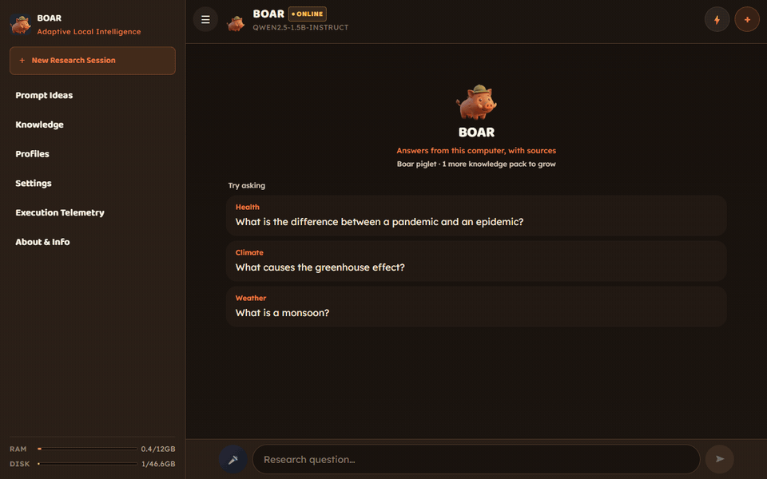
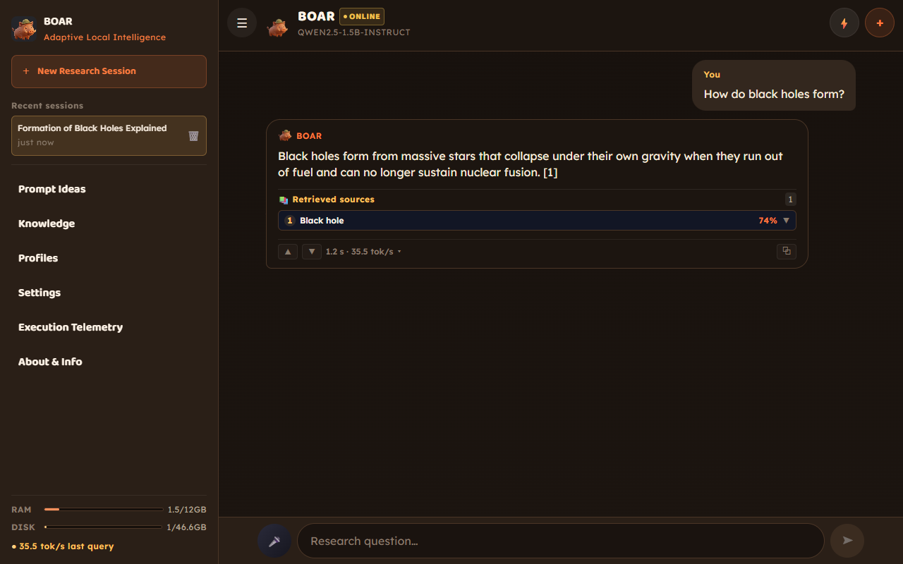
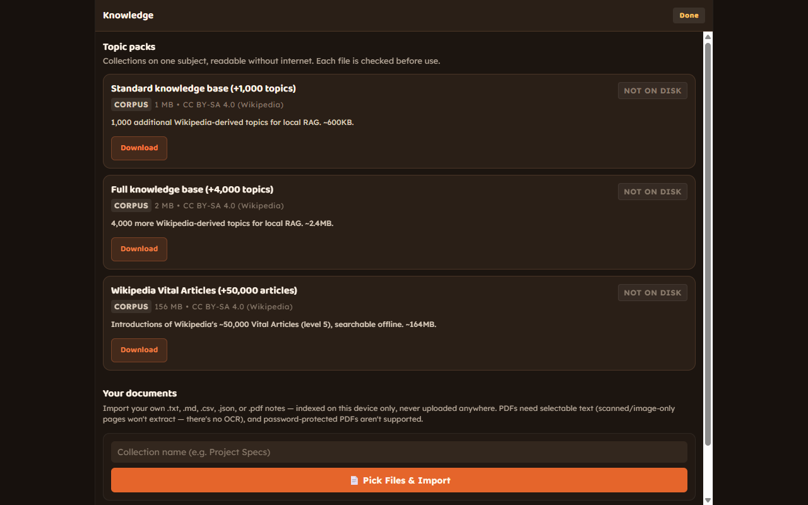
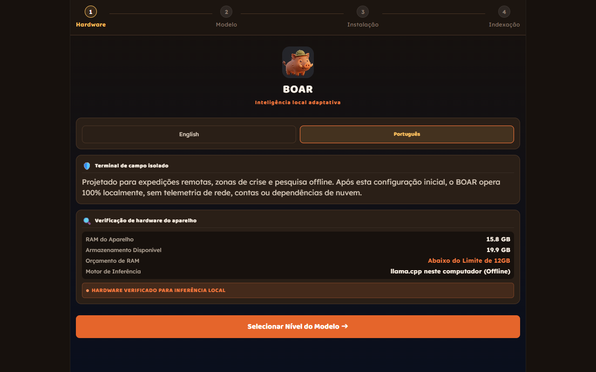
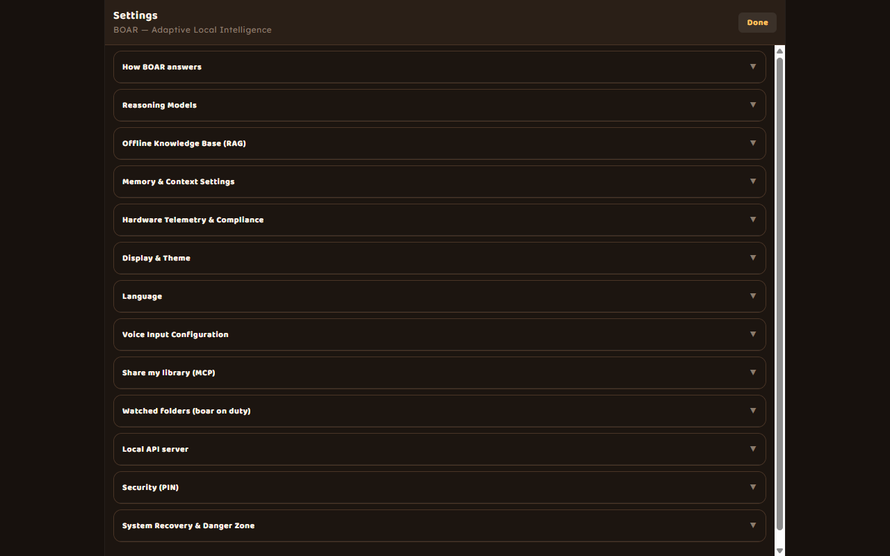

<p align="center">
  
</p>

<h1 align="center">BOAR for desktop</h1>

<p align="center">
  <b>AI that works when the internet doesn't.</b><br />
  A research assistant that runs entirely on your computer, answers from Wikipedia and your own files,<br />
  and shows where every answer came from.<br />
  <sub>The boar grows up as your library does.</sub>
</p>

<p align="center">
  <a href="https://github.com/Bielcx/boar-desktop/releases/latest"></a>
  
  
  
  <a href="./LICENSE"></a>
</p>

<p align="center">
  
</p>

<p align="center">
  <a href="#download">Download</a> ·
  <a href="#what-it-does">What it does</a> ·
  <a href="#speed">Speed</a> ·
  <a href="#connect-other-apps">Connect other apps</a> ·
  <a href="#privacy">Privacy</a> ·
  <a href="#build-from-source">Build from source</a>
</p>

## Why

Chat assistants stop working when the connection goes, and everything you ask them goes to someone else's server.
BOAR downloads a small language model **once**, then answers on your own machine: no account, no cloud, no
telemetry. It doesn't make things up from thin air either: every answer is grounded in passages it retrieved, and
each passage is a numbered source you can open.

<table>
<tr>
<td width="50%"></td>
<td width="50%"></td>
</tr>
<tr>
<td><b>Answers with sources.</b> Open a citation to read the exact passage. Each answer shows its time and speed.</td>
<td><b>Knowledge you choose.</b> Wikipedia packs up to 50,000 articles, plus your own <code>.txt</code>, <code>.md</code>, <code>.csv</code>, <code>.json</code> and <code>.pdf</code> files.</td>
</tr>
<tr>
<td width="50%"></td>
<td width="50%"></td>
</tr>
<tr>
<td><b>Set up once.</b> English or Portuguese, a check of this computer, one download. Offline from then on.</td>
<td><b>Yours to tune.</b> Models, theme, voice, sharing with other apps, a PIN. Everything is off until you turn it on.</td>
</tr>
</table>

## Download

> [!WARNING]
> **Beta.** BOAR for desktop (Windows and Linux) is early software, made for builders who want to try it and help
> shape it. Expect rough edges, and keep anything important backed up. Found a bug?
> [Open an issue](https://github.com/Bielcx/boar-desktop/issues). A security problem? See [SECURITY.md](SECURITY.md).

Every version is on the [releases page](https://github.com/Bielcx/boar-desktop/releases/latest), built by GitHub
Actions from the tagged code, with a `SHA256SUMS.txt` for its files.

**Windows 10 or 11**

1. **[Download BOAR-Setup.exe](https://github.com/Bielcx/boar-desktop/releases/latest/download/BOAR-Setup.exe)** (about 131 MB).
2. Run it. It installs for your user only (no administrator password) and adds a Start menu shortcut.
3. The installer isn't code-signed yet, so Windows SmartScreen will warn you: click **More info → Run anyway**.

**Linux (64-bit)**

- `BOAR.AppImage` runs on most distributions without installing: `chmod +x BOAR.AppImage`, then open it.
- On Ubuntu or Debian, `BOAR.deb` installs it: `sudo apt install ./BOAR.deb`.

**First launch.** BOAR checks your computer and downloads its model from Hugging Face, checking its SHA-256: Qwen3 4B
(2.5 GB) on computers with 8 GB of RAM or more, Qwen3 1.7B (1.1 GB) on lighter ones. After that you can unplug
the network.

**Needs:** a 64-bit computer with Windows 10 or 11, or Linux; 8 GB of RAM for the default model (it uses about 3 GB
while answering); about 3.5 GB of disk for the app and the model. Any GPU that speaks Vulkan (NVIDIA, AMD, Intel)
makes it much faster, and without one it runs on the CPU.

**Uninstall.** Windows: Settings › Apps › BOAR. Linux: delete the AppImage, or `sudo apt remove boar-desktop`. Your data
(models, documents, chats) stays in `%APPDATA%\BOAR` or `~/.config/BOAR`; delete that folder to remove it too.

## What it does

- **Answers from a local library.** Hybrid search (SQLite full-text plus embeddings, both on your machine) finds
  the passages, and the model writes from them. When nothing relevant turns up, it says so instead of guessing.
- **Picks how deep to go.** A short question can be answered by a sentence straight from the source in under a
  second; a harder one gets the model over the best passages; "Go deeper" spends more time.
- **Reads your documents.** Import notes and PDFs into collections, ask about one collection only, toggle or
  export them. PDFs need selectable text (there's no OCR).
- **Watches a folder.** Point BOAR at a folder and new files get indexed by themselves, with a notification and a
  boar in the system tray.
- **Listens and speaks.** Voice input with whisper.cpp, transcribed on your computer (the 60 MB voice model is
  downloaded the first time you press the microphone). Answers can be read aloud.
- **Profiles.** A name, a tone, which collections it may read, and how the boar looks, applied to a whole
  conversation.
- **Locks with a PIN.** Chats are encrypted on disk with a key sealed by your PIN and by your system account (on
  Linux, the desktop keyring).
- **Brings your own model.** Search Hugging Face for GGUF models from inside the app, or switch between Qwen3 4B
  and the lighter Qwen3 1.7B in Settings.

## Speed

Measured with the app's own benchmark (`npm run bench -- --full --wiki` in `desktop/`) on a mid-range laptop:
GTX 1650 (4 GB), Qwen3 4B Q4_K_M, Vulkan, an English Wikipedia pack installed. Three runs of the same 26 questions,
21 October 2026.

| | |
|---|---|
| Quality | **17 of 18** fact checks right in every run, and 0 made-up answers to questions it should decline |
| Generation | **about 30 tok/s** median in answers (27–30 across the runs) |
| First word | **1.3–1.5 s** median |
| Whole answer | 17–19 s median, for full, detailed answers |
| Library search | 0.2–0.3 s median, in a pack of 390,000 articles |
| Memory | about 3 GB of RAM, 3.4 GB of VRAM for the model |

Raw runs: [desktop/bench/results](desktop/bench/results) (`2026-10-21-stab-v4-r1..3-full.json`).

## Connect other apps

Both are **off by default** and only ever listen on your own computer.

**Share your library over MCP.** Claude Desktop, Cursor or any MCP client can search the collections you pick and
get passages back with their sources (stdio, read-only, no network port). Settings → *Share my library (MCP)* has a
button that copies the configuration for Claude Desktop.

**A local, OpenAI-compatible API.** Settings → *Local API server* starts a server on `127.0.0.1:41414` with tokens
you create in the app (stored only as hashes, with an expiry and a rate limit):

```bash
curl http://127.0.0.1:41414/v1/chat/completions \
  -H "Authorization: Bearer boar_..." -H "Content-Type: application/json" \
  -d '{"messages":[{"role":"user","content":"What is a black hole?"}]}'
```

Tested with the official OpenAI SDK for Node. Answers carry their sources in `boar_sources`, and
`POST /v1/library/search` returns passages only. More: [desktop/docs/10-api.md](desktop/docs/10-api.md).

## Privacy

- After setup, nothing leaves your computer. The network is used only for things you start yourself: downloads
  (models, knowledge packs, the voice model), searching Hugging Face, and sharing an evaluation run's scores.
- No account, no analytics, no crash reporting.
- The window is sandboxed: the interface can't reach the disk or the network on its own, only through a fixed list
  of operations in the main process, each confined to BOAR's own folders. Details:
  [desktop/docs/06-seguranca.md](desktop/docs/06-seguranca.md).

## Build from source

You need Node.js 24 and a 64-bit Windows 10/11 or Linux.

```bash
git clone https://github.com/Bielcx/boar-desktop.git && cd boar-desktop
npm install                  # the app (run it from PowerShell or cmd, not Git Bash)
cd desktop && npm install    # Electron and the native Node packages
npm run dev                  # dev server + Electron, with reload
npm run dist                 # -> desktop/release/: the installer on Windows, AppImage and .deb on Linux
```

Tests: `npm test` at the root and in `desktop/`; `npm run e2e` in `desktop/` drives the real app with Playwright.
Releases are built by GitHub Actions when a `v*` tag is pushed (see [RELEASING.md](RELEASING.md)).

## How it's built

The interface and the answer engine are the [BOAR Android app](https://github.com/rferrari/boar-app)'s, unchanged.
Expo exports them for the web, and Electron runs that export in a window. Each native package the app expects
(`llama.rn`, `expo-sqlite`, the file system…) is swapped at bundle time for a small shim that calls the main
process, where `node-llama-cpp`, `node:sqlite` and whisper.cpp do the work.

| | |
|---|---|
| `src/` | the app: interface, chat, routing, retrieval, models |
| `desktop/` | Electron: main process, preload, shims, handlers, tests, packaging ([desktop/README.md](desktop/README.md)) |
| `desktop/docs/` | how each part was built, in Portuguese |
| `docs/` | the engine: [routing](docs/ADAPTIVE_ROUTING.md), [models](docs/MODELS.md), [knowledge packs](docs/KNOWLEDGE_PACKS.md) |
| `scripts/` | knowledge pack builders |

## Credits and license

BOAR for desktop builds on [BOAR](https://github.com/rferrari/boar-app) by the aoair contributors, made for the
[poidh "Best Offline AI Research App" bounty](https://poidh.xyz/mainnet/bounty/31). Models: Qwen by Alibaba Cloud;
inference: [llama.cpp](https://github.com/ggml-org/llama.cpp); knowledge: Wikipedia (CC BY-SA 4.0).

MIT, see [LICENSE](LICENSE).
