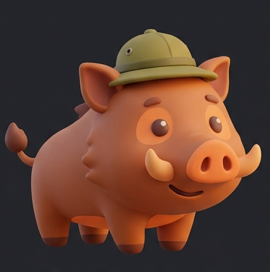

<p align="center">
  
</p>

<h1 align="center">BOAR for desktop</h1>

<p align="center">
  <b>AI that works when the internet doesn't.</b><br />
  An open-source research assistant that runs entirely on your computer, and shows where every answer came from.
</p>

BOAR runs a local language model and searches your own documents and offline knowledge packs. After a one-time
model download, nothing leaves your machine. This repository is the **desktop app** (Windows; Electron). It
started from the [BOAR Android app](https://github.com/rferrari/boar-app) and reuses its interface and engine:
the Expo web build of `src/` runs inside Electron, and `desktop/src/shims` swap each native package for one that
calls Node in the main process.

## Get it

Download `BOAR Setup <version>.exe` from [Releases](../../releases) and run it (per-user install, unsigned:
Windows SmartScreen asks you to confirm).

## Build from source

```bash
npm install                  # the app (repo root)
cd desktop && npm install    # Electron and the native Node packages
npm run dev                  # dev server + Electron
npm run dist                 # -> desktop/release/BOAR Setup <ver>.exe
```

Details, scripts and layout: [desktop/README.md](desktop/README.md). Notes for coding agents: [AGENTS.md](AGENTS.md).

## Layout

| | |
|---|---|
| `src/` | the app: UI (`src/ui-android`, shared with the Android app), chat, RAG, models |
| `desktop/` | Electron main process, preload, shims, handlers, tests, packaging |
| `modules/` | the TypeScript side of the app's native modules (the desktop shims replace them) |
| `scripts/` | knowledge pack and corpus builders |
| `supabase/` | optional backend for evaluation results users choose to share |

## License

MIT, see [LICENSE](LICENSE).
